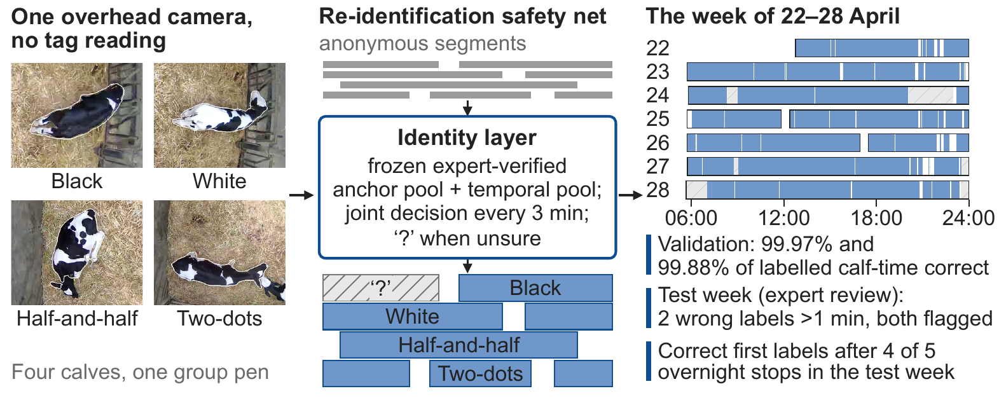

<p align="center">
  
</p>

<h1 align="center">Resilient re-ID framework for trackers with over 99 % accuracy</h1>

<p align="center"><i>A lightweight re-identification safety net under a tracker, tested for a week on four look-alike dairy calves</i></p>

<p align="center">
  <a href="https://sonam525.github.io/Re-id-for-tracking/"></a>
  <a href="https://huggingface.co/datasets/Sonam5/Calf-Identity-Tracking-Masks"></a>
  <a href="https://huggingface.co/Sonam5/Calf-Identity-Tracking-Weights"></a>
  <a href="https://github.com/Sonam525/FarmSAM"></a>
  <a href="LICENSE"></a>
</p>

<p align="center">
  <a href="#how-it-works">How it works</a> ·
  <a href="#results">Results</a> ·
  <a href="#what-makes-the-re-id-work">What makes it work</a> ·
  <a href="#masks">Masks</a> ·
  <a href="#code">Code</a> ·
  <a href="#licences">Licences</a> ·
  <a href="#citation">Citation</a>
</p>

Video tracking can follow objects in one environment for days. Production spaces such as farms and factories already keep a record of each target, as text or from sensors, and aligning vision with these records could support longitudinal analyses. Trackers, however, switch identities over long video, and one switch misaligns the rest of a target's history. Instead of chasing tracking scores, we built a lightweight re-identification safety net under a tracker. The tracker follows targets as anonymous segments; the safety net names every segment from appearance, revises a name when later evidence disagrees, and leaves a segment unlabelled ("?") or flags it for review when the evidence is weak.

A farm is our test case, and a hard one: four black and white dairy calves that look alike from above, one overhead camera, infrared nights, and a recording stop of almost six hours every night, so that no track survives from one day to the next.

- **Over 99 % of labelled time correct.** 99.97 % and 99.88 % on the two validation days, and 99.27 % on 04-24, the one test day with a reference identity for every minute (a veterinarian's interval notes).
- **Five test days without an exchange of labels.** Over 90 h of test video, no exchange of two calves' labels was found, and both wrong labels that lasted more than a minute were flagged for review.
- **Names come back after the night.** Every first label was correct after five of the six overnight recording stops.
- **"?" instead of a guess.** A doubtful segment stays unlabelled, so an error does not run on for hours.
- **Lightweight.** A 22-million-parameter DINOv3 embedding was at least as accurate as a 6.7-billion-parameter one, and the identity layer runs on a CPU.

<p align="center"></p>
<p align="center"><sub>The safety net at work. The tracker's segments come in anonymous and leave with a calf's name, or "?". Right: the labels over the week of 22 to 28 April, minute by minute (blue, named; hatched, "?"). Videos of every day are on the <a href="https://sonam525.github.io/Re-id-for-tracking/#videos">project page</a>.</sub></p>

## How it works

<p align="center"></p>

**The tracker follows, but never names.** A SAM 3 video tracker with a backbone distilled for calves ([FarmSAM](https://github.com/Sonam525/FarmSAM)) follows each animal and writes anonymous segments, one mask per animal per frame. A fine-tuned RF-DETR detector re-seeds it when an animal is lost. Inside a segment, identity follows the masks, and appearance never steers the tracker.

**The safety net names the segments, offline.** Every 15 s, each segment's masked crop is embedded with DINOv3 ViT-S/16, separately for the top, middle and bottom third of the body. Every 3 minutes the identity layer scores each segment against each animal and assigns them jointly, so that two segments at the same time never share a name. A crop is matched to its five most similar individual exemplars in two pools:

- a **frozen anchor pool** of 30,588 crops from the two training days, whose identities a veterinarian verified;
- a **temporal pool** that collects the week's confidently labelled crops.

The scores are blended 0.6 anchor to 0.4 temporal. The frozen anchors bound how far the self-fed pool can drift.

**Doubt is visible.** A name changes only when the evidence clearly favours another animal, and then for the whole run (the part of a segment that carries one label), backward as well as forward. When the evidence is thin, the layer writes "?" or flags the segment for review. Four rules for a closed pen use the fact that it holds exactly four calves. Each morning, the new segments are named against both pools like any other segment.

**Clean masks.** Where a mask breaks into fragments, the detector repairs it, and a colour check hides any track that is clearly not a black and white calf. Neither step reads identity.

## Results

The study uses whole days as units. 04-18 and 04-19 are the training days, and the week of 04-22 to 04-28 starts 60 hours later. Of that week, 04-22 and 04-23 were used for validation, ablations and tuning, and 04-24 to 04-28 were set aside as test days. Every reported setting is supported by the validation days alone; 04-24 was scored in some early design comparisons before it was set aside, which the paper's supplement lists. Scores are in calf-minutes (one calf for one minute). The accuracy of labelled time is correct ÷ (correct + wrong): "?" and time without a mask are left out and reported on their own.

### Validation days

| Day | Labelled time correct | Wrong, flagged (calf-min) | Wrong, silent (calf-min) | Left as "?" (calf-min) | With a reference (calf-min) |
|:---|---:|---:|---:|---:|---:|
| 04-22 | **99.97 %** | 0.00 | 0.83 | 0.63 | 2,557.94 |
| 04-23 | **99.88 %** | 0.54 | 4.14 | 3.89 | 4,127.48 |

The reference is an identity chain that the veterinarian reviewed end to end on overlay video. Over both days the layer was wrong for 5.5 calf-minutes in 111 calf-hours, all of it in daylight. The last half hour of 04-23, a pen-wide disturbance, is scored separately and not included above (93.31 % correct).

### Test days

The veterinarian reviewed the five test days (90.46 h of video) at 50× speed: 04-25 to 04-28 end to end on the final system's video, and 04-24 interval by interval on an earlier version's video.

- **No exchange of two calves' labels was found.**
- **Two wrong labels lasted more than a minute, and both were flagged for review.** At the feeder on 04-24, a tracker mask hopped to a neighbouring calf, and a later joint decision gave the whole segment that calf's label, including about 10 minutes before the hop (08:20 to 08:30). After the last night, on 04-28, one calf carried another's label for 20 minutes until the layer corrected it at 06:00.
- **04-24 has a reference identity for every minute**, from the veterinarian's interval notes. Against the notes as written, 99.27 % of labelled time was correct, and 5.2 % of the reference time was left as "?". Re-examining only the intervals where the system and the notes disagreed showed that the notes placed one exchange 8.7 minutes early and recorded one that the tracks rule out. With these two change points corrected, accuracy is 99.70 %; because only disagreements were re-examined, this correction can only favour the system, so both scores are given, the notes as written first.
- **Caution costs coverage.** Over the test days, 96.11 % of track time carried a calf label. The longest unlabelled stretch was on the evening of 04-24, after a contest over one calf's identity.

### After each overnight stop

| Night | First labels in the morning | Checked against |
|:---|:---|:---|
| 04-22 to 04-23 | All correct | Reviewed identity chain |
| 04-23 to 04-24 | All correct | Veterinarian's interval notes |
| 04-24 to 04-25 | No wrong identity found | Expert review of the video |
| 04-25 to 04-26 | No wrong identity found | Expert review of the video |
| 04-26 to 04-27 | No wrong identity found | Expert review of the video |
| 04-27 to 04-28 | One calf wrong for 20 min, flagged; correct from 06:00 | Expert review of the video |

### Tracking front end and cost

- **Mask refinement** cut fragmented-mask time on the test days from 24.56 to 3.90 track-hours and removed all 19 fragment episodes of 10 minutes or more.
- **Tracking** ran at 3.76 fps on one A10 GPU (1.33 GPU-hours per hour of video), within 2.45 GiB of GPU memory. The identity layer runs offline on a CPU.
- **One-time human input:** the veterinarian watched 38 minutes of 50× overlay video of the training days and named the calves once on a sheet of stills.

**Scope.** One pen, four calves, one camera and one week. The method uses no calf-specific trait, but it has been tested only on calves. No frame has hand-drawn mask ground truth. The tables are in [`results/`](results).

## What makes the re-ID work

The design follows four lessons, each measured on the validation days.

1. **One crop is too weak; many crops decide.** Seen from above, the calves differ mainly in how much of the coat is white and where, and infrared light washes this out. A single crop names the right calf 87.92 % of the time. Assigned jointly in 5-minute windows against a correctly labelled pool, the same crops give 99.26 % right decisions, because per-crop errors do not line up. The layer therefore never names a calf from one crop, and keeps deciding: on tracks of an earlier tracker version, deciding once per segment labelled 85.56 % of frames correctly on 04-22 (46.5 % at night, where one low-margin decision swapped two calves), while re-deciding jointly every 3 minutes made no silent error on either validation day.
2. **Appearance must not steer the tracker.** The first version let the appearance pool re-assign the four tracks at regular intervals. With evidence this weak per crop, it permuted tracks that the tracker had been following correctly: in three tracked stretches of the validation days, 47.6 % of 197,213 frames carried a wrong label. Inside a segment, association is spatial and belongs to the tracker. Identity is decided by a separate layer that sees the whole timeline, may revise a label and may abstain.
3. **Individual exemplars, not averages.** A running average per calf and hour blurs posture-specific evidence. Matching a crop with its five most similar individual exemplars beat hourly averages of the same features by 6.16 percentage points (95 % CI 3.73 to 8.77), on 536 query windows of 04-22. Splitting each crop into top, middle and bottom thirds did not raise accuracy (94.59 % against 95.34 % for whole crops, a tie), but correct decisions had larger margins (0.0595 against 0.0469), so the split was kept.
4. **A pool fed by its own labels locks in its first error; frozen anchors stop it.** One wrong decision that enters the pool attracts more crops of the wrong calf and becomes a self-consistent swap. On earlier tracks, 99.26 % of 5-minute windows were right against a correctly labelled pool, but 92.00 % when the matcher's own decisions fed the pool, and only 54.26 % on the night of 04-22. The frozen anchor pool of verified training-day crops is the reference this loop cannot corrupt. On identical final tracks, the labelled time correct on 04-22 and 04-23 was:

| Pool | 04-22 | 04-23 | Night of 04-22 |
|:---|---:|---:|---:|
| Temporal pool rebuilt every morning | 90.66 % | 91.56 % | 59.80 % |
| Temporal pool accumulated over the week | 94.87 % | 99.90 % | 74.52 % |
| + frozen anchors | 99.97 % | 99.90 % | 100 % |
| + colour filter (final system) | **99.97 %** | **99.88 %** | 100 % |

Other settings compared on the validation days:

| Setting | Final choice | Compared with | Result |
|:---|:---|:---|:---|
| Cue | DINOv3 embedding | Colour histogram; last-seen position | Embedding +11.38 and +24.81 pts over all queries; colour fails at night (57.9 %), position by day (63.6 %) |
| Anchor weight | 0.6 | 0 to 1 | Every labelled crop correct at every weight; crops flagged 1.9 % against 23.9 % without anchors and 11.1 % with anchors alone |
| Window length | 3 min | 5 min | 95.3 / 96.8 % against 77.1 / 80.5 % of crops labelled, no silent error at either |
| Unnamed last calf | Assign it and flag it | Leave it unlabelled | Coverage on 04-23 97.6 % against 78.3 %, no silent error |
| Backbone | DINOv3 ViT-S/16 | ViT-B, ViT-L, ViT-7B | Below |

The cue comparison used the original SAM 3 tracks; anchor weight, window length, the last-calf rule and the backbones used tracks of an earlier tracker version. [`results/ablation.csv`](results/ablation.csv) lists each comparison with its tracks, and the paper's supplement gives every comparison in full.

**A small embedding model is enough.** On the same crops, the smallest DINOv3 model was the most accurate per crop. In 5-minute windows all four were within sampling error of each other, because aggregation over time, not model capacity, carries the decision.

| Backbone | Parameters | Embedding size | Per crop | 5-min windows |
|:---|---:|---:|---:|---:|
| **ViT-S/16** | **22 M** | **384** | **87.92 %** | 99.26 % |
| ViT-B/16 | 86 M | 768 | 85.91 % | 98.97 % |
| ViT-L/16 | 303 M | 1,024 | 86.75 % | 99.34 % |
| ViT-7B/16 | 6,716 M | 4,096 | 84.87 % | 99.04 % |

Per crop: 6,814 decisions. Windows: 1,355 five-minute windows against a correctly labelled pool. All four models named every calf correctly after the 04-22 to 04-23 night.

## Weights

The calf tracker backbone (the distilled SAM 3 student) and the calf RF-DETR-Seg detector are at [Sonam5/Calf-Identity-Tracking-Weights](https://huggingface.co/Sonam5/Calf-Identity-Tracking-Weights), with loading notes. SAM 3 itself comes from Meta under its gate.

## Masks

The masks are at [Sonam5/Calf-Identity-Tracking-Masks](https://huggingface.co/datasets/Sonam5/Calf-Identity-Tracking-Masks), one gzipped JSON file per video clip, with a run-length mask for each tracker slot and frame (5 fps). A small file per day maps slots to calves over time.

| Set | Days |
|:---|:---|
| Generated, final refined masks with identities | 04-22 to 04-28 |
| Verified, an earlier pass with identity labels checked or reviewed by people (details on the dataset card) | 04-18, 04-19, 04-22, 04-23, 04-24 |

Read one with NumPy only:

```bash
python examples/decode_masks.py masks_FarmA_R1_ch01-20240425-054428-061038.json.gz
```

The video is camera `FarmA_R1` of the [Calf Play Behavior Dataset](https://huggingface.co/datasets/Sonam5/Calf-Play-Behavior-Dataset) (doi:[10.57967/hf/11689](https://doi.org/10.57967/hf/11689)), described in its dataset paper ([arXiv:2611.21706](https://arxiv.org/abs/2611.21706)). Each mask file carries the name of its clip there. Since version 1.2 of that dataset its videos are public, with the people in the barn covered by a mosaic.

## Code

[`code/`](code/README.md) holds the pipeline as it ran: decoding, the detector, the tracker, crops and embeddings, the anchor pool, the identity layer, the colour filter and mask refinement. The scripts were written as Databricks notebooks, so paths need changing for your setup. Training the tracker's student backbone is covered in [FarmSAM](https://github.com/Sonam525/FarmSAM).

| Path | What it holds |
|:---|:---|
| [`code/`](code/README.md) | The pipeline scripts, in run order |
| [`examples/`](examples) | A mask decoder that needs only NumPy |
| [`results/`](results) | The result tables as CSV |
| [`figures/`](figures) | The figures and the script that draws them |
| [`docs/`](docs) | The project page |

## Licences

| Item | Terms |
|:---|:---|
| Code in this repository | MIT, see [`LICENSE`](LICENSE) |
| Masks and labels | [SAM License](LICENSES/SAM_LICENSE.txt), because they come from SAM 3 and a student distilled from it |
| [SAM 3](https://huggingface.co/facebook/sam3) | SAM License, gated. Download it yourself |
| Calf student and calf detector | SAM License, at [Calf-Identity-Tracking-Weights](https://huggingface.co/Sonam5/Calf-Identity-Tracking-Weights) and in [FarmSAM](https://huggingface.co/Sonam5/FarmSAM) |
| DINOv3 ViT-S/16 | DINOv3 License. Download it yourself |
| RF-DETR (library) | Apache-2.0 |

Licence holder: Haiyu Yang. See [`NOTICE.md`](NOTICE.md).

## Citation

The paper is in preparation. Until then, please cite this repository ([`CITATION.cff`](CITATION.cff)), the distillation paper (arXiv:2604.27128), the video dataset (doi:10.57967/hf/11689) and its dataset paper (arXiv:2611.21706).
