<p align="center">
  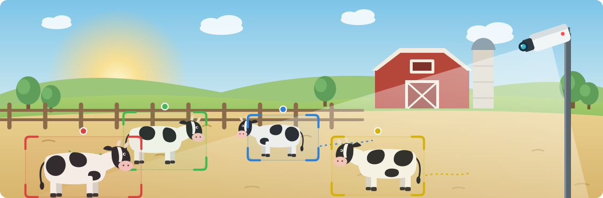
</p>

<h1 align="center">Re-ID for consistent tracking</h1>

<p align="center"><i>A lightweight re-identification safety net under a tracker, tested for a week on four look-alike dairy calves</i></p>

<p align="center">
  <a href="https://sonam525.github.io/Re-id-for-tracking/"></a>
  <a href="https://huggingface.co/datasets/Sonam5/Calf-Identity-Tracking-Masks"></a>
  <a href="https://huggingface.co/Sonam5/Calf-Identity-Tracking-Weights"></a>
  <a href="https://github.com/Sonam525/FarmSAM"></a>
  <a href="LICENSE"></a>
</p>

<p align="center">
  <a href="#videos">Videos</a> ·
  <a href="#how-it-works">How it works</a> ·
  <a href="#results">Results</a> ·
  <a href="#what-makes-the-re-id-work">What makes it work</a> ·
  <a href="#masks">Masks</a> ·
  <a href="#code">Code</a> ·
  <a href="#licences">Licences</a> ·
  <a href="#citation">Citation</a>
</p>

Video tracking can follow objects in one environment for days. Production spaces such as farms and factories already keep a record of each target, as text or from sensors, and aligning vision with these records could support longitudinal analyses. Trackers, however, switch identities over long video, and one switch misaligns the rest of a target's history. Instead of chasing tracking scores, we built a lightweight re-identification safety net under a tracker. The tracker follows targets as anonymous segments; the safety net names every segment from appearance, revises a name when later evidence disagrees, and leaves a segment unlabelled ("?") or flags it for review when the evidence is weak.

A farm is our test case, and a hard one: four black and white dairy calves that look alike from above, one overhead camera, infrared nights, and a recording stop of almost six hours every night, so that no track survives from one day to the next.

## Videos

The videos show the system best. One video per day of the week of 04-22 to 04-28, each colour one calf, at 50× speed with the clock in every frame. Select a day to play it. While people are in the pen the picture is mosaicked, and the feed alley beyond the rail is mosaicked throughout.

<table>
<tr><td align="center"><a href="https://huggingface.co/datasets/Sonam5/Calf-Identity-Tracking-Masks/resolve/main/videos/week/20240422_identities.mp4">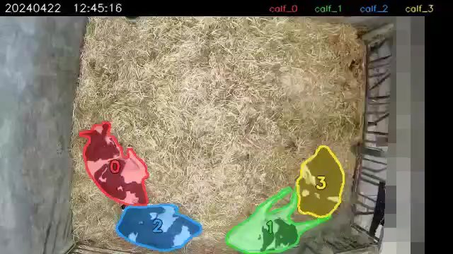</a><br><sub><b>04-22</b>, validation</sub></td><td align="center"><a href="https://huggingface.co/datasets/Sonam5/Calf-Identity-Tracking-Masks/resolve/main/videos/week/20240423_identities.mp4">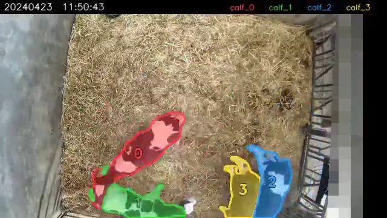</a><br><sub><b>04-23</b>, validation</sub></td><td align="center"><a href="https://huggingface.co/datasets/Sonam5/Calf-Identity-Tracking-Masks/resolve/main/videos/week/20240424_identities.mp4">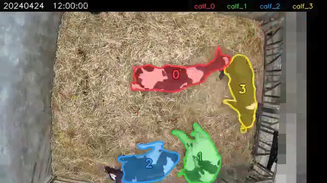</a><br><sub><b>04-24</b>, test</sub></td><td align="center"><a href="https://huggingface.co/datasets/Sonam5/Calf-Identity-Tracking-Masks/resolve/main/videos/week/20240425_identities.mp4">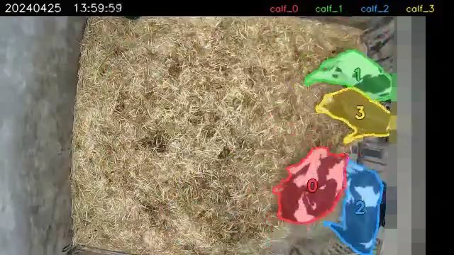</a><br><sub><b>04-25</b>, test</sub></td></tr>
<tr><td align="center"><a href="https://huggingface.co/datasets/Sonam5/Calf-Identity-Tracking-Masks/resolve/main/videos/week/20240426_identities.mp4">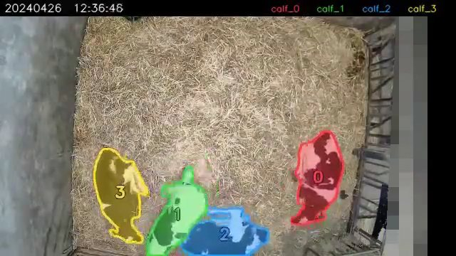</a><br><sub><b>04-26</b>, test</sub></td><td align="center"><a href="https://huggingface.co/datasets/Sonam5/Calf-Identity-Tracking-Masks/resolve/main/videos/week/20240427_identities.mp4">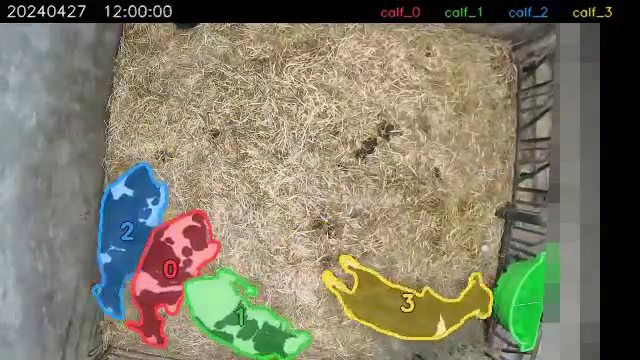</a><br><sub><b>04-27</b>, test</sub></td><td align="center"><a href="https://huggingface.co/datasets/Sonam5/Calf-Identity-Tracking-Masks/resolve/main/videos/week/20240428_identities.mp4">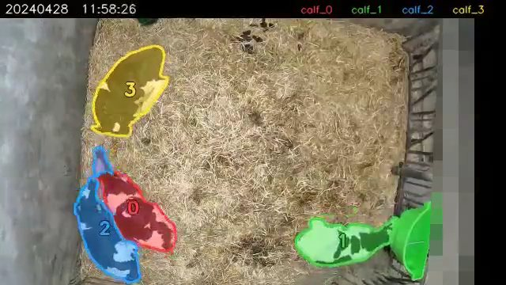</a><br><sub><b>04-28</b>, test</sub></td><td align="center"><a href="https://sonam525.github.io/Re-id-for-tracking/#videos"><sub>All videos with a player<br>on the project page</sub></a></td></tr>
</table>

<table>
<tr><td align="center" width="50%"><a href="https://huggingface.co/datasets/Sonam5/Calf-Identity-Tracking-Masks/resolve/main/videos/20240423_1800-2400_teacher_student.mp4">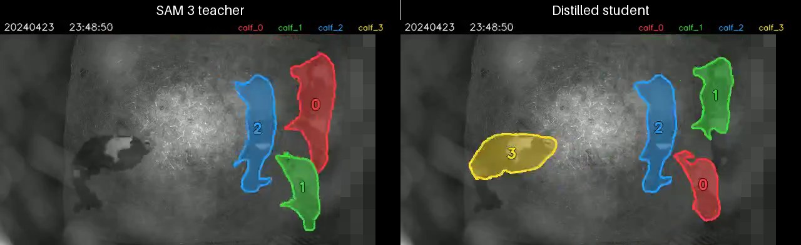</a><br><sub><b>Teacher and student</b>, 04-23 18:00 to midnight. Left, the tracker with SAM 3's own backbone; right, with the distilled student. From about 23:30 the teacher loses calves; the student keeps all four. Colours are tracker slots.</sub></td>
<td align="center" width="50%"><a href="https://sonam525.github.io/Re-id-for-tracking/media/20240422_1641-1748_refine_side_by_side.mp4">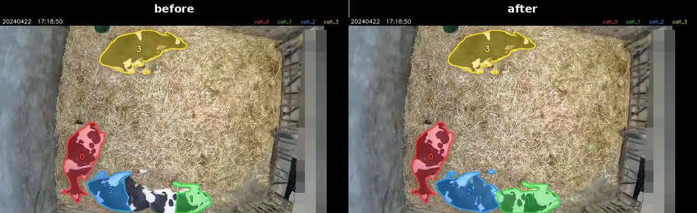</a><br><sub><b>Mask refinement</b>, 04-22 16:41 to 17:48. Tracked masks before (left) and after (right) refinement.</sub></td></tr>
</table>

**Highlights**

- **Over 99 % of labelled time correct.** 99.97 % and 99.88 % on the two validation days, and 99.27 % on 04-24, the one test day with a reference identity for every minute (a veterinarian's interval notes).
- **Five test days without an exchange of labels.** Over 90 h of test video, no exchange of two calves' labels was found, and both wrong labels that lasted more than a minute were flagged for review.
- **Names come back after the night.** Every first label was correct after five of the six overnight recording stops.
- **"?" instead of a guess.** A doubtful segment stays unlabelled, so an error does not run on for hours.
- **Lightweight.** A 22-million-parameter DINOv3 embedding was at least as accurate as a 6.7-billion-parameter one, and the identity layer runs on a CPU.

## How it works

<p align="center">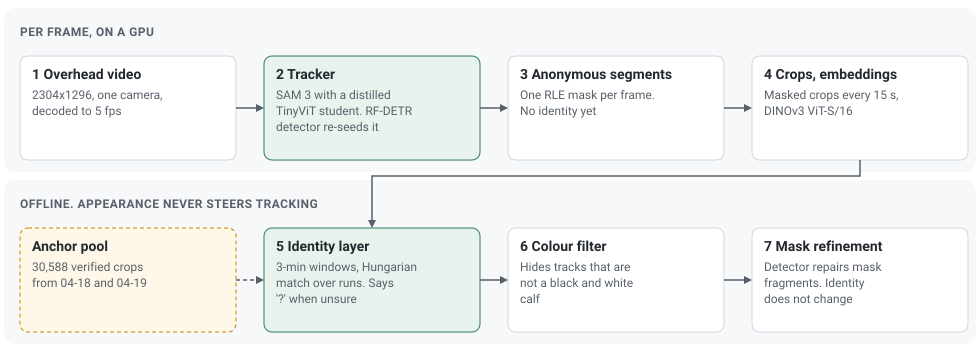</p>

**The tracker follows, but never names.** A SAM 3 video tracker with a backbone distilled for calves ([FarmSAM](https://github.com/Sonam525/FarmSAM)) follows each animal and writes anonymous segments, one mask per animal per frame. A fine-tuned RF-DETR detector re-seeds it when an animal is lost. Inside a segment, identity follows the masks, and appearance never steers the tracker.

**The safety net names the segments, offline.** Every 15 s, each segment's masked crop is embedded with DINOv3 ViT-S/16, separately for the top, middle and bottom third of the body. Every 3 minutes the identity layer scores each segment against each animal and assigns them jointly, so that two segments at the same time never share a name. A crop is matched to its five most similar individual exemplars in two pools:

- a **frozen anchor pool** of 30,588 crops from the two training days, whose identities a veterinarian verified;
- a **temporal pool** that collects the week's confidently labelled crops.

The scores are blended 0.6 anchor to 0.4 temporal. The frozen anchors bound how far the self-fed pool can drift.

<p align="center">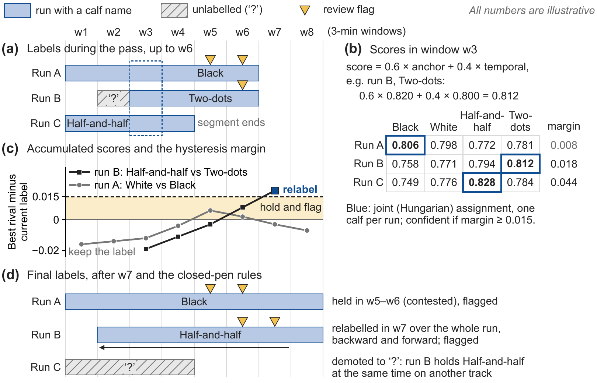</p>
<p align="center"><sub>How the layer decides, with illustrative numbers. (a) Labels of three runs during the pass; triangles, review flags. (b) One window: each run scored against each calf as 0.6 × anchor + 0.4 × temporal, then assigned jointly. (c) A label changes only once the accumulated evidence clears the 0.015 margin. (d) Final labels: one run relabelled backward and forward, one demoted to "?".</sub></p>

**Doubt is visible.** A name changes only when the evidence clearly favours another animal, and then for the whole run (the part of a segment that carries one label), backward as well as forward. When the evidence is thin, the layer writes "?" or flags the segment for review. Four rules for a closed pen use the fact that it holds exactly four calves. Each morning, the new segments are named against both pools like any other segment.

**Clean masks.** Where a mask breaks into fragments, the detector repairs it, and a colour check hides any track that is clearly not a black and white calf. Neither step reads identity.

## Results

The study uses whole days as units. 04-18 and 04-19 are the training days, and the week of 04-22 to 04-28 starts 60 hours later. Of that week, 04-22 and 04-23 were used for validation, ablations and tuning, and 04-24 to 04-28 were set aside as test days. Every reported setting is supported by the validation days alone; 04-24 was scored in some early design comparisons before it was set aside, which the paper's supplement lists. Scores are in calf-minutes (one calf for one minute). The accuracy of labelled time is correct ÷ (correct + wrong): "?" and time without a mask are left out and reported on their own.

### Validation days

| Day | Labelled time correct | Wrong, flagged (calf-min) | Wrong, silent (calf-min) | Left as "?" (calf-min) | With a reference (calf-min) |
|:---|---:|---:|---:|---:|---:|
| 04-22 | **99.97 %** | 0.00 | 0.83 | 0.63 | 2,557.94 |
| 04-23 | **99.88 %** | 0.54 | 4.14 | 3.89 | 4,127.48 |

The reference is an identity chain that the veterinarian reviewed end to end on overlay video. Over both days the layer was wrong for 5.5 calf-minutes in 111 calf-hours, all of it in daylight. The last half hour of 04-23, a pen-wide disturbance, is scored separately and not included above (93.31 % correct).

### Test days

The veterinarian reviewed the five test days (90.46 h of video) at 50× speed: 04-25 to 04-28 end to end on the final system's video, and 04-24 interval by interval on an earlier version's video.

- **No exchange of two calves' labels was found.**
- **Two wrong labels lasted more than a minute, and both were flagged for review.**

### After each overnight stop

| Night | First labels in the morning | Checked against |
|:---|:---|:---|
| 04-22 to 04-23 | All correct | Reviewed identity chain |
| 04-23 to 04-24 | All correct | Veterinarian's interval notes |
| 04-24 to 04-25 | No wrong identity found | Expert review of the video |
| 04-25 to 04-26 | No wrong identity found | Expert review of the video |
| 04-26 to 04-27 | No wrong identity found | Expert review of the video |
| 04-27 to 04-28 | One calf wrong for 20 min, flagged; correct from 06:00 | Expert review of the video |

## What makes the re-ID work

Each part of the identity layer was compared with its alternatives on the validation days. The design rests on four lessons:

| Lesson | Evidence on the validation days |
|:---|:---|
| **One crop is too weak; many crops decide** | 87.92 % of single crops named correctly, against 99.26 % of 5-minute windows matched against a correctly labelled pool |
| **Appearance must not steer the tracker** | An early version that re-assigned tracks by appearance left 43.8 % of 427,932 frames with a wrong label, up to 99 % in busy evenings (figure below) |
| **Individual exemplars, not averages** | +6.16 points over hourly averages of the same features (panel c below) |
| **A self-fed pool locks in its first error; frozen anchors stop it** | 92.00 % of windows with a self-fed pool against 99.26 % with a correct one; the anchors fixed the first night, 74.52 → 100 % (panel d below) |

<p align="center">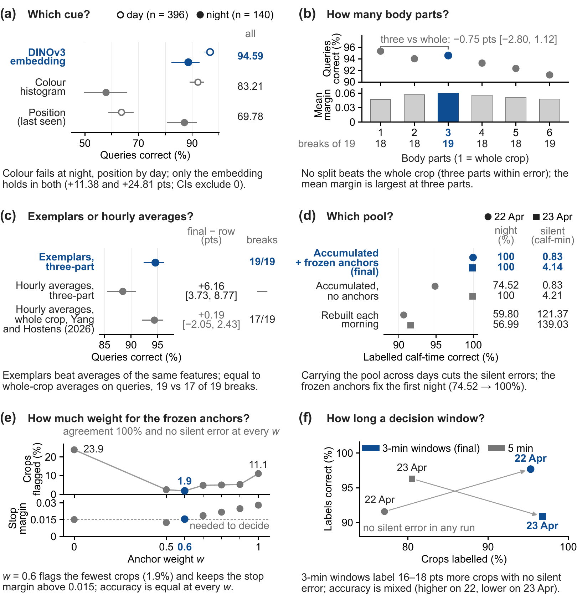</p>
<p align="center"><sub>Each part compared with its alternatives (blue, final choice; grey, alternatives). (a–c) 536 five-minute queries of 04-22 on the original SAM 3 tracks; whiskers, 95 % intervals. (d) Identical final tracks, before the colour filter. (e, f) Tracks of an earlier tracker version.</sub></p>

<p align="center">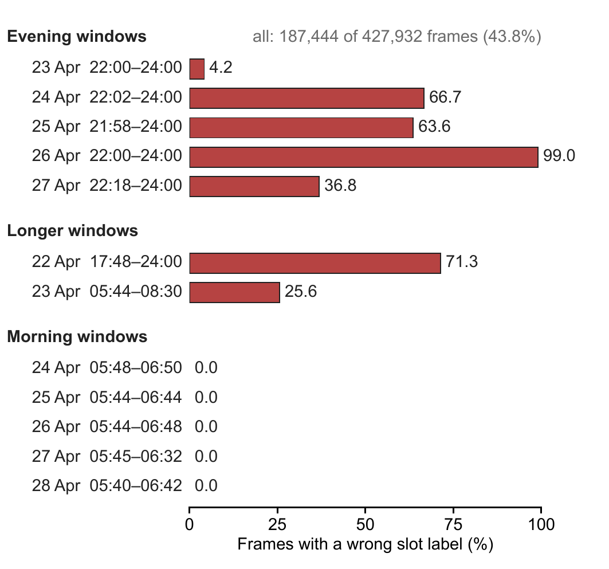</p>
<p align="center"><sub>Why appearance must not steer the tracker. An early tracker version let the appearance pool re-assign the four tracks every few minutes; the bars give the share of frames whose stored label disagreed with the identity chain restored afterwards by frame-to-frame mask matching. Settled mornings were unaffected; busy evenings were not.</sub></p>

**A small embedding model is enough.** The smallest DINOv3 model, ViT-S/16 with 22 million parameters, was the most accurate per crop (a). In 5-minute windows all four models were within sampling error of each other (b), because aggregation over time, not model capacity, carries the decision. Its embeddings are a tenth the size of ViT-7B's (c).

<p align="center">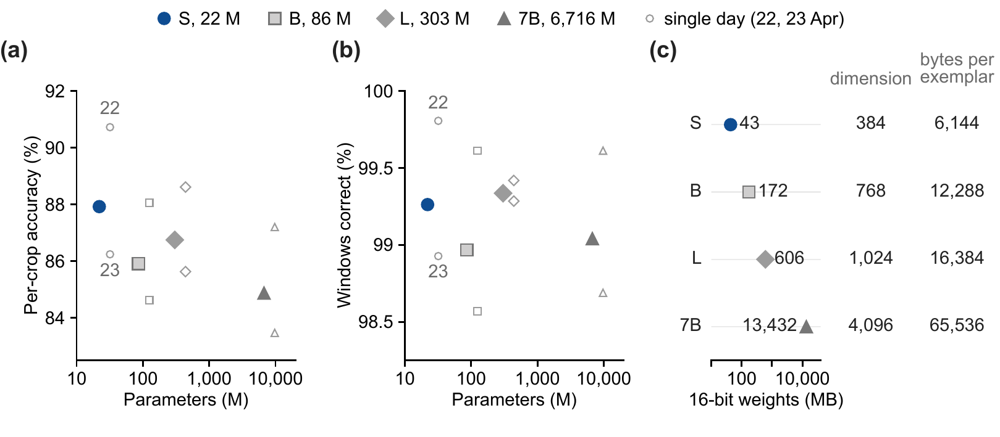</p>
<p align="center"><sub>DINOv3 backbones on the validation days, three-part embedding: (a) per-crop accuracy and (b) 5-minute windows against a correctly labelled pool, against parameters (log scale; small open markers, single days); (c) 16-bit weights, embedding dimension and bytes per stored exemplar.</sub></p>

The numbers behind each figure are in [`results/`](results), and the paper's supplement gives every comparison in full.

## Weights

The calf tracker backbone (the distilled SAM 3 student) and the calf RF-DETR-Seg detector are at [Sonam5/Calf-Identity-Tracking-Weights](https://huggingface.co/Sonam5/Calf-Identity-Tracking-Weights), with loading notes. SAM 3 itself comes from Meta under its gate.

## Masks

The masks are at [Sonam5/Calf-Identity-Tracking-Masks](https://huggingface.co/datasets/Sonam5/Calf-Identity-Tracking-Masks), one gzipped JSON file per video clip, with a run-length mask for each tracker slot and frame (5 fps). A small file per day maps slots to calves over time.

| Set | Days |
|:---|:---|
| Generated, final refined masks with identities | 04-22 to 04-28 |
| Verified, an earlier pass with identity labels checked or reviewed by people (details on the dataset card) | 04-18, 04-19, 04-22, 04-23, 04-24 |

Read one with NumPy only:

```bash
python examples/decode_masks.py masks_FarmA_R1_ch01-20240425-054428-061038.json.gz
```

The video is camera `FarmA_R1` of the [Calf Play Behavior Dataset](https://huggingface.co/datasets/Sonam5/Calf-Play-Behavior-Dataset) (doi:[10.57967/hf/11689](https://doi.org/10.57967/hf/11689)), described in its dataset paper ([arXiv:2611.21706](https://arxiv.org/abs/2611.21706)). Each mask file carries the name of its clip there. Since version 1.2 of that dataset its videos are public, with the people in the barn covered by a mosaic.

## Code

[`code/`](code/README.md) holds the pipeline as it ran: decoding, the detector, the tracker, crops and embeddings, the anchor pool, the identity layer, the colour filter and mask refinement. The scripts were written as Databricks notebooks, so paths need changing for your setup. Training the tracker's student backbone is covered in [FarmSAM](https://github.com/Sonam525/FarmSAM).

| Path | What it holds |
|:---|:---|
| [`code/`](code/README.md) | The pipeline scripts, in run order |
| [`examples/`](examples) | A mask decoder that needs only NumPy |
| [`results/`](results) | The result tables as CSV |
| [`figures/`](figures) | The figures and the script that draws them |
| [`docs/`](docs) | The project page |

## Licences

| Item | Terms |
|:---|:---|
| Code in this repository | MIT, see [`LICENSE`](LICENSE) |
| Masks and labels | [SAM License](LICENSES/SAM_LICENSE.txt), because they come from SAM 3 and a student distilled from it |
| [SAM 3](https://huggingface.co/facebook/sam3) | SAM License, gated. Download it yourself |
| Calf student and calf detector | SAM License, at [Calf-Identity-Tracking-Weights](https://huggingface.co/Sonam5/Calf-Identity-Tracking-Weights) and in [FarmSAM](https://huggingface.co/Sonam5/FarmSAM) |
| DINOv3 ViT-S/16 | DINOv3 License. Download it yourself |
| RF-DETR (library) | Apache-2.0 |

Licence holder: Haiyu Yang. See [`NOTICE.md`](NOTICE.md).

## Citation

The paper is in preparation. Until then, please cite this repository ([`CITATION.cff`](CITATION.cff)), the distillation paper (arXiv:2604.27128), the video dataset (doi:10.57967/hf/11689) and its dataset paper (arXiv:2611.21706).
