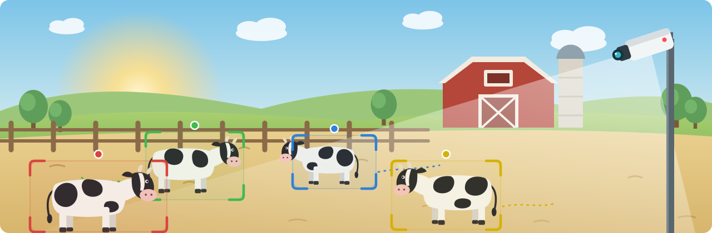
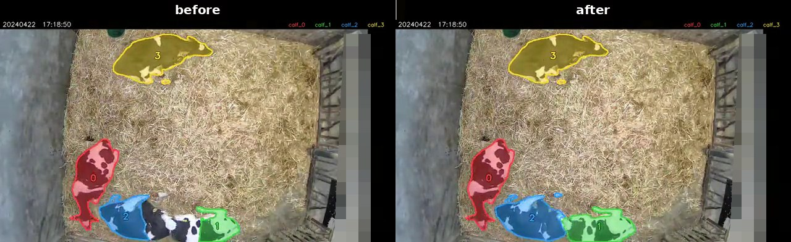
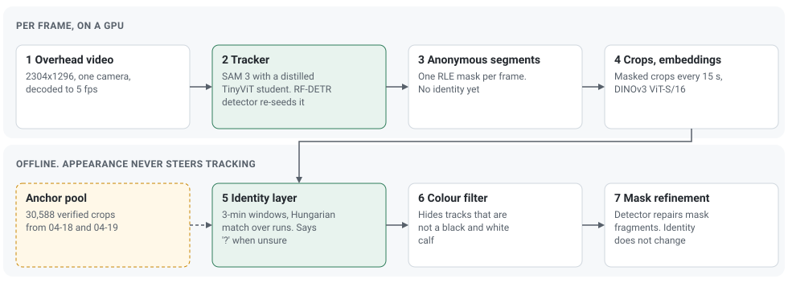

<p align="center">
  
</p>

<h1 align="center">Which calf is which, across a week</h1>

<p align="center">
  <a href="https://sonam525.github.io/Re-id-for-tracking/"></a>
  <a href="https://huggingface.co/datasets/Sonam5/Calf-Identity-Tracking-Masks"></a>
  <a href="https://github.com/Sonam525/FarmSAM"></a>
  <a href="LICENSE"></a>
</p>

<p align="center">
  <a href="#how-it-works">How it works</a> ·
  <a href="#results">Results</a> ·
  <a href="#masks">Masks</a> ·
  <a href="#code">Code</a> ·
  <a href="#licences">Licences</a> ·
  <a href="#citation">Citation</a>
</p>

Records for each animal, such as growth, feeding or play, need every animal to keep its name from one day to the next. A tracker can hold an identity only while it sees the animal move. A farm camera that stops every night breaks that chain. This project tracks four dairy calves with one overhead camera for a week, and gives each calf its name back every morning.

- **A full week, one identity per calf.** Seven days of overhead video, six nights with the camera off, and each calf recovered after every night.
- **99.27 % of labelled time correct** on the held-out test day, checked against expert notes.
- **"?" instead of a guess.** When the evidence is thin the system leaves a calf unlabelled, so an error does not run on for hours.
- **Masks for every frame, released.** Per-frame calf masks for the training days and the whole test week are on [Hugging Face](https://huggingface.co/datasets/Sonam5/Calf-Identity-Tracking-Masks).

<p align="center"><a href="docs/media/20240422_1641-1748_refine_side_by_side.mp4"></a></p>
<p align="center"><sub>Tracked masks before and after refinement, 2024-04-22, 50× speed. Click for the clip. A video for every day of the week, and the SAM 3 teacher and the distilled student side by side, are on the <a href="https://sonam525.github.io/Re-id-for-tracking/#videos">project page</a>.</sub></p>

## How it works

<p align="center"></p>

**Track first, name later.** A SAM 3 video tracker with a distilled backbone from [FarmSAM](https://github.com/Sonam525/FarmSAM) follows the calves and writes anonymous segments, one mask per calf per frame. An RF-DETR detector re-seeds it when a calf is lost. The tracker never decides who a calf is.

**Identity from appearance, offline.** Masked crops of each segment are embedded with DINOv3 ViT-S/16. Every 3 minutes the identity layer compares them with verified crops from two training days and solves a joint assignment for the four calves. Each morning starts fresh, so the names are earned again after every night.

**Clean masks.** Where a mask breaks into fragments, the detector repairs it. Repair never touches identity.

## Results

The week of 2024-04-22 to 04-28 starts 60 hours after the two training days. 04-22 and 04-23 were used for validation, and 04-24 to 04-28 were held out. Times are calf-minutes: one calf for one minute.

| Day | Labelled time correct | Trusted calf-minutes correct | Left as "?" |
|:---|---:|---:|---:|
| **04-24, held-out test** | **99.27 %** | 93.0 % of 3,825.5 | 5.2 % |
| 04-22, validation | 99.97 % | 98.45 % of 2,557.9 | 0.02 % |
| 04-23, validation | 99.89 % | 98.1 % of 4,127.5 | 0.09 % |

**After every night.** All six night gaps ended on the right identities. On 04-28 one calf took about 20 minutes after dawn to get its correct label. A veterinarian reviewed 04-25 to 04-28 at 50× speed and found no other wrongly assigned identity.

**Mask refinement.** Fragmented masks fell from 24.56 to 3.90 slot-hours over 04-24 to 04-28, and every fragment episode of 10 minutes or more was repaired.

**A small embedding model is enough.** DINOv3 ViT-S/16 (22 M parameters) matched ViT-B, ViT-L and the 6.7 B ViT-7B on these calves, so the smallest model stays.

| Backbone | Parameters | Per-crop rank-1 | Re-ID in 5-min windows |
|:---|---:|---:|---:|
| **ViT-S/16** | **22 M** | **88.0 %** | 98.8 % |
| ViT-B/16 | 86 M | 86.2 % | 98.6 % |
| ViT-L/16 | 303 M | 87.1 % | 98.9 % |
| ViT-7B/16 | 6,716 M | 85.5 % | 98.6 % |

More detail, with the timeline of the week, is on the [project page](https://sonam525.github.io/Re-id-for-tracking/#results). The tables are in [`results/`](results).

**Scope.** One pen, four black and white calves, one camera and one week. Identity is decided offline; tracking runs at about 3.75 fps on an A10 GPU. Only 04-24 has numeric identity ground truth, and no frame has pixel-level mask ground truth.

## Weights

The calf tracker backbone (the distilled SAM 3 student) and the calf RF-DETR-Seg detector are at [Sonam5/Calf-Identity-Tracking-Weights](https://huggingface.co/Sonam5/Calf-Identity-Tracking-Weights), with loading notes. SAM 3 itself comes from Meta under its gate.

## Masks

The masks are at [Sonam5/Calf-Identity-Tracking-Masks](https://huggingface.co/datasets/Sonam5/Calf-Identity-Tracking-Masks), one gzipped JSON file per video clip, with a run-length mask for each tracker slot and frame (5 fps). A small file per day maps slots to calves over time.

| Set | Days |
|:---|:---|
| Generated, final refined masks with identities | 04-22 to 04-28 |
| Verified, an earlier pass with identity labels checked or reviewed by people (details on the dataset card) | 04-18, 04-19, 04-22, 04-23, 04-24 |

Read one with NumPy only:

```bash
python examples/decode_masks.py masks_FarmA_R1_ch01-20240425-054428-061038.json.gz
```

The video is camera `FarmA_R1` of the [Calf Play Behavior Dataset](https://huggingface.co/datasets/Sonam5/Calf-Play-Behavior-Dataset) (doi:10.57967/hf/10912), and each mask file carries the name of its clip there. The video files of this camera follow once people who appear in the pen are masked.

## Code

[`code/`](code/README.md) holds the pipeline as it ran: decoding, the detector, the tracker, crops and embeddings, the identity layer and mask refinement. The scripts were written as Databricks notebooks, so paths need changing for your setup. Training the tracker's student backbone is covered in [FarmSAM](https://github.com/Sonam525/FarmSAM).

| Path | What it holds |
|:---|:---|
| [`code/`](code/README.md) | The pipeline scripts, in run order |
| [`examples/`](examples) | A mask decoder that needs only NumPy |
| [`results/`](results) | The result tables as CSV |
| [`figures/`](figures) | The figures and the script that draws them |
| [`docs/`](docs) | The project page |

## Licences

| Item | Terms |
|:---|:---|
| Code in this repository | MIT, see [`LICENSE`](LICENSE) |
| Masks and labels | [SAM License](LICENSES/SAM_LICENSE.txt), because they come from SAM 3 and a student distilled from it |
| [SAM 3](https://huggingface.co/facebook/sam3) | SAM License, gated. Download it yourself |
| Calf student and calf detector | SAM License, at [Calf-Identity-Tracking-Weights](https://huggingface.co/Sonam5/Calf-Identity-Tracking-Weights) and in [FarmSAM](https://huggingface.co/Sonam5/FarmSAM) |
| DINOv3 ViT-S/16 | DINOv3 License. Download it yourself |
| RF-DETR (library) | Apache-2.0 |

Licence holder: Haiyu Yang. See [`NOTICE.md`](NOTICE.md).

## Citation

The paper is in preparation. Until then, please cite this repository ([`CITATION.cff`](CITATION.cff)), the distillation paper (arXiv:2604.27128) and the video dataset (doi:10.57967/hf/10912).
